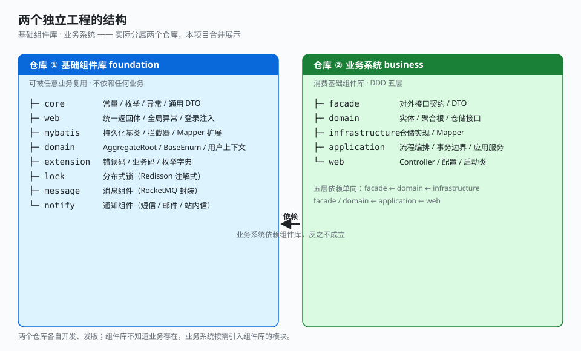

# 1.1 多模块分层树

本项目包含两个本应独立的工程：**基础组件库**（foundation，可被任意业务复用的技术组件）与**业务系统**（business，消费该组件库的具体业务）。实际中二者分属两个仓库各自演进；此处为展示方便置于同一目录，但应作为两个工程来理解。

## 关键点

- **两个独立工程，不是一个项目的两块**：基础组件库与业务系统各自开发、发版；组件库不知道有任何业务存在，业务系统依赖组件库而非反之。阅读时把它们当两个仓库看。
- **基础组件库内部不是一锅粥**：core 是零依赖内核（异常、返回体、通用 DTO），web / mybatis / domain / extension 各管一摊，lock / message / notify 是三个独立中间件封装，按需引入。
- **业务系统按 DDD 分层**：facade（对外契约）→ domain（领域核心）→ infrastructure（落地实现）→ application（流程编排）→ web（启动接入），依赖单向，下面讲。

---

← [总目录](../README.md) ｜ [下一节：1.2 pom 依赖方向](./02-pom-dependency.md) →
