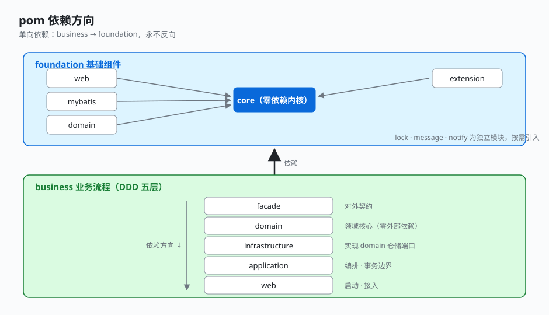

# 1.2 pom 依赖方向

模块多不可怕，可怕的是依赖乱。这个工程的依赖方向**严格单向**，用一句话概括：**business 依赖 foundation，foundation 永远不反向依赖 business。**

## 依赖方向图

```
                 ┌──────── foundation（基础组件）────────┐
                 │   core ← web                          │
                 │   core ← mybatis                      │
                 │   core ← domain                       │
                 │   core ← extension                    │
                 │   (lock / message / notify 独立)      │
                 └───────────────────────────────────────┘
                                   ▲
                                   │ 依赖
                                   │
┌──────── business（业务流程，DDD 五层）────────┐
│   facade ← domain ← infrastructure           │
│   facade / domain ← application ← web        │
└──────────────────────────────────────────────┘
```



## 用 pom 代码佐证

**foundation-web 只依赖 core，不碰任何 business：**

```xml
<!-- demo-foundation-web/pom.xml -->
<dependencies>
    <dependency>
        <groupId>com.demo</groupId>
        <artifactId>demo-foundation-core</artifactId>
    </dependency>
    <dependency>
        <groupId>com.demo</groupId>
        <artifactId>demo-foundation-domain</artifactId>
    </dependency>
    <!-- spring-boot-starter-web / aop / openfeign / fastjson -->
</dependencies>
```

**business-application 依赖 domain + facade + foundation-web + foundation-lock，方向永远向下：**

```xml
<!-- demo-business-application/pom.xml -->
<dependencies>
    <dependency><groupId>com.demo</groupId><artifactId>demo-business-domain</artifactId></dependency>
    <dependency><groupId>com.demo</groupId><artifactId>demo-business-facade</artifactId></dependency>
    <dependency><groupId>com.demo</groupId><artifactId>demo-foundation-web</artifactId></dependency>
    <dependency><groupId>com.demo</groupId><artifactId>demo-foundation-lock</artifactId></dependency>
</dependencies>
```

## 关键点

- **单向依赖是复用的前提**：foundation 不依赖 business，所以可以把 foundation 整包拷到另一个业务工程直接用。如果 foundation 里出现了一行 `import com.demo.business...`，这条线就断了——这是评审红线。
- **DDD 五层依赖也单向**：domain 不依赖 infrastructure（领域不关心落地），infrastructure 依赖 domain 实现仓储；application 编排 domain，web 启动 application。倒过来就乱。
- **版本统一在根 POM 的 `dependencyManagement`**：所有内部模块版本用 `${demo.version}`，子模块引用不写 version，避免版本漂移。

---

← [上一节：1.1 多模块分层树](./01-module-tree.md) ｜ [下一节：1.3 DDD 五层职责](./03-ddd-layers.md) →
