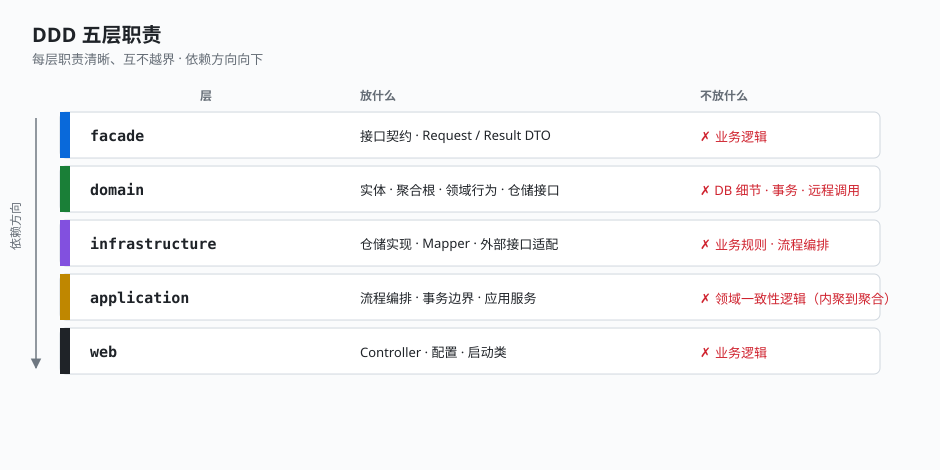

# 1.3 DDD 五层职责

business 模块按 DDD 分五层，每层职责清晰、互不越界。用一张表说清「放什么、不放什么」：

| 层 | 模块 | 放什么 | 不放什么 |
|----|------|--------|----------|
| **facade** | demo-business-facade | 对外接口契约、Request/Result DTO | 任何业务逻辑 |
| **domain** | demo-business-domain | 实体、聚合根、领域行为、仓储接口 | DB 细节、事务、远程调用 |
| **infrastructure** | demo-business-infrastructure | 仓储实现、Mapper、外部接口适配 | 业务规则、流程编排 |
| **application** | demo-business-application | 流程编排、事务边界、应用服务、DTO↔领域转换 | 领域一致性逻辑（应内聚到聚合） |
| **web** | demo-business-web | Controller、Spring 配置、启动类 | 业务逻辑 |



## 以 trade 域为例看分层落点

以唯一的业务域 trade（电商交易：下单 + 合并支付结算）为例，同一个「下单」能力，五层各分担一部分：

```
web          TradeController.placeOrder()           接 HTTP，调应用服务
application  TradeAppService.placeOrder()            开事务边界，调处理器链
             TradeActionExecutor.placeProcess(ctx)   编排 4 个 processor
domain       SalesOrder.assignOrderNo/recalc...      聚合内聚行为
             SalesOrderRepository（接口）            仓储端口
infrastructure SalesOrderRepositoryImpl              落 MyBatis-Plus
             SalesOrderEntityMapper                 SQL 落地
facade       PlaceOrderRequest / PlaceOrderResult   对外契约 DTO
```

## 关键点

- **domain 是核心，零外部依赖**：domain 只依赖 foundation-domain 的基类，不依赖 mybatis、不依赖 spring-web。领域逻辑可以脱离框架单独测试。
- **infrastructure 实现 domain 的仓储接口**：依赖方向是 infrastructure → domain（实现端口），不是 domain → infrastructure。这保证了领域不关心落地方式。
- **application 是「编排层」不是「业务层」**：应用服务开事务、调处理器链，但**写聚合字段的逻辑不在这一层**——那条规则在 1.4 和第三部分会重点讲。
- **facade 独立成模块**：外部调用方只依赖 facade（接口契约 + DTO），不被迫拖入整个领域实现。内部服务间互调也走 facade。

---

← [上一节：1.2 pom 依赖方向](./02-pom-dependency.md) ｜ [下一节：1.4 聚合根与基类](./04-aggregate-base.md) →
