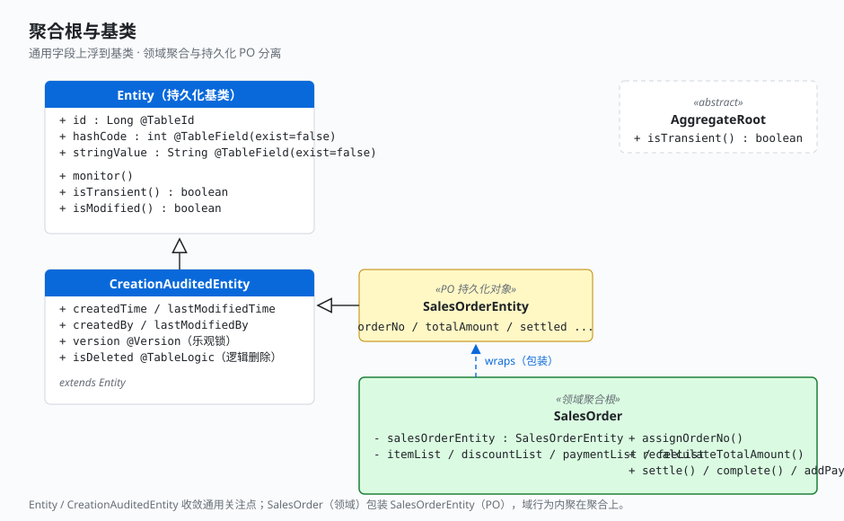

# 1.4 聚合根与基类

这一节看工程的「骨架代码」。美感来自两件事：**持久化基类把通用关注点收敛到一处**，以及**领域聚合与持久化 PO 分离**。

## 持久化基类：Entity → CreationAuditedEntity

`Entity` 是所有持久化对象的基类，把「主键 + 是否新建 + 变更监控」三件事收在一起：

```java
// foundation-mybatis: com.demo.foundation.mybatis.entities.Entity
public class Entity implements Serializable {
    @TableId(value = "id", type = IdType.AUTO)
    private Long id;

    @TableField(exist = false)   // 不入库，仅做变更快照
    private int hashCode;
    @TableField(exist = false)
    private String stringValue;

    public void monitor() {       // 加载后由拦截器调用，写入快照
        this.hashCode = hashCode();
        this.stringValue = this.toString();
    }

    public boolean isTransient() { return this.id == null || this.id <= 0; }

    public boolean isModified() { /* 对比当前哈希/字符串与快照，判断是否变更 */ }
}
```

`CreationAuditedEntity` 在此之上加审计字段、乐观锁、逻辑删除——业务实体只声明业务字段，这些通用字段一个都不用写：

```java
// foundation-mybatis: CreationAuditedEntity extends Entity
public class CreationAuditedEntity extends Entity {
    private LocalDateTime createdTime;
    private LocalDateTime lastModifiedTime;
    private String createdBy;
    private String lastModifiedBy;
    @Version    private Integer version;      // 乐观锁
    @TableLogic private Integer isDeleted = 0; // 逻辑删除
}
```



## 领域聚合：与 PO 分离

重点来了：**领域聚合根不直接继承持久化基类**。trade 的 `SalesOrder` 是领域聚合，它**包装**持久化实体 `SalesOrderEntity`（PO），并在自己身上承载所有域行为：

```java
// business-domain: com.demo.business.domain.trade.entity.SalesOrder
public class SalesOrder implements Serializable {

    @Setter private SalesOrderEntity salesOrderEntity;   // 持久化 PO
    @Setter private List<OrderItem>  itemList;           // 子实体集合
    @Setter private List<Discount>   discountList;
    @Setter private List<Payment>    paymentList;
    @Setter private List<Fee>        feeList;

    /** 分配单号并下推到所有子实体，保证聚合内单号一致 */
    public void assignOrderNo(String orderNo, String groupNo) {
        salesOrderEntity.setOrderNo(orderNo);
        salesOrderEntity.setMergePayGroupId(groupNo);
        itemList.forEach(i  -> i.setOrderNo(orderNo));
        discountList.forEach(d -> d.setOrderNo(orderNo));
        paymentList.forEach(p -> p.setOrderNo(orderNo));
        feeList.forEach(f    -> f.setOrderNo(orderNo));
    }

    /** 重算总金额 = 商品小计 − 优惠 + 费项，写回主实体 */
    public void recalculateTotalAmount() {
        BigDecimal itemTotal    = sum(itemList,    OrderItem::getSubtotal);
        BigDecimal discountTotal = sum(discountList, Discount::getAmount);
        BigDecimal feeTotal      = sum(feeList,     Fee::getAmount);
        salesOrderEntity.setTotalAmount(itemTotal.subtract(discountTotal).add(feeTotal));
    }

    public void settle(UserRequestContext ctx) { /* 标记已支付 */ }
    public void complete(UserRequestContext ctx) { /* 确认收货 */ }
}
```

> foundation-domain 还提供了一个 `AggregateRoot` 抽象基类（仅声明 `isTransient()`），作为领域聚合根的标记位。trade 当前聚合以「包装 PO + 持有子集合」的方式实现，行为全部内聚在聚合上。

## 关键点

- **通用字段上浮到基类**：审计、乐观锁、逻辑删除、变更监控全在 `Entity`/`CreationAuditedEntity`，业务实体只写业务字段，代码极度干净。
- **领域聚合 ≠ 持久化 PO**：`SalesOrder`（领域）包装 `SalesOrderEntity`（PO），域行为写在聚合上、不散落在 service。这是后面「聚合内聚」规则的物质基础。
- **变更监控是后面 2.4 落库极简的前置**：`monitor()` 写快照、`isModified()` 比对——业务代码完全不用手动标记「我改了哪个字段」。

---

← [上一节：1.3 DDD 五层职责](./03-ddd-layers.md) ｜ [下一节：1.5 processor 编排入口](./05-action-executor.md) →
