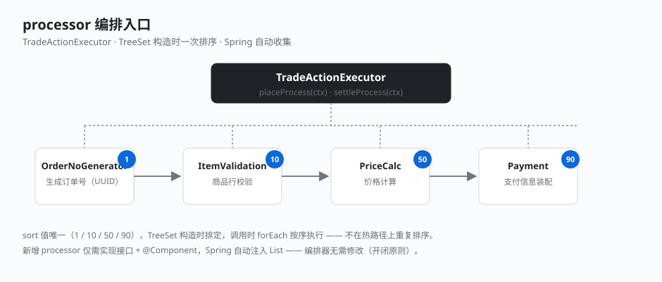

# 1.5 processor 编排入口

业务流程怎么串起来？答案是**处理器链 + 编排器**。一个业务流程拆成若干 processor，每个只做一件事，按固定顺序执行。这个编排入口的设计极其简洁。

## 处理器接口：自排序

每个 processor 实现同一接口，并实现 `Comparable`——排序由 `getSort()` 决定，值小者先执行：

```java
// business-application: com.demo.business.application.trade.place.PlaceOrderProcessor
public interface PlaceOrderProcessor extends Comparable<PlaceOrderProcessor> {
    void process(PlaceOrderContext context);
    int getSort();                          // 执行顺序，值小者先

    @Override
    default int compareTo(PlaceOrderProcessor other) {
        return Integer.compare(this.getSort(), other.getSort());
    }
}
```

结算处理器 `SettleProcessor` 是一模一样的结构，只是处理 `SettleContext`。

## 编排器：TreeSet 构造时排序

`TradeActionExecutor` 是整个流程的入口。它的优雅在于——**排序只做一次**：

```java
// business-application: com.demo.business.application.trade.TradeActionExecutor
@Service
public class TradeActionExecutor {

    private final Set<PlaceOrderProcessor> placeProcessors;
    private final Set<SettleProcessor>      settleProcessors;

    public TradeActionExecutor(List<PlaceOrderProcessor> placeProcessors,
                               List<SettleProcessor>      settleProcessors) {
        this.placeProcessors  = new TreeSet<>(placeProcessors);   // 构造时一次排定
        this.settleProcessors = new TreeSet<>(settleProcessors);
    }

    public void placeProcess(PlaceOrderContext context) {
        placeProcessors.forEach(p -> p.process(context));          // 直接按序执行
    }

    public void settleProcess(SettleContext context) {
        settleProcessors.forEach(p -> p.process(context));
    }
}
```



## 关键点

- **Spring 自动收集**：构造器注入 `List<PlaceOrderProcessor>`，Spring 把所有实现 bean 自动塞进来，新增 processor 不用改编排器——**开闭原则**。
- **TreeSet 构造时排序，不每次排序**：processor 装进 `TreeSet` 时就按 `compareTo` 排定了，调用时 `forEach` 直接按序跑，没有 `stream().sorted()` 的开销。这是很小的细节，但体现了「不要在热路径上做可前置的计算」。
- **processor 只做编排能做的事**：生成策略、跨聚合协调、调用聚合行为。**写聚合字段的逻辑不在 processor 里**——那条线在第三部分会反复看到。
- **sort 值唯一**：下单链 1/10/50/90，结算链 10/50，互不冲突，`TreeSet` 不会因 `compareTo` 返回 0 误丢处理器。

---

← [上一节：1.4 聚合根与基类](./04-aggregate-base.md) ｜ [下一节：2.1 锁的一种优雅实现](../02-foundation-elegance/01-lock.md) →
