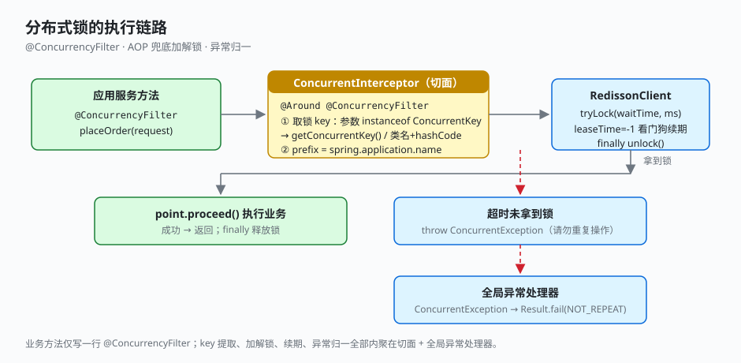

# 2.1 锁的一种优雅实现

并发控制最容易把业务代码写脏。先看这个工程里业务侧怎么用锁，再看这一行注解背后做了什么。

## 先看怎么用

下单应用服务方法上加一个注解：

```java
// business-application: TradeAppServiceImpl
@Override
@ConcurrencyFilter(waitTime = 1000, leaseTime = 5000)
public List<PlaceOrderResult> placeOrder(PlaceOrderRequest request) {
    PlaceOrderContext context = OrderFactory.create(request);
    tradeActionExecutor.placeProcess(context);                 // 事务外：单号/校验/算价/支付
    context.getGroup().joinGroup(context.getOrderList(), ...);
    transactionTemplate.executeWithoutResult(status -> {       // 事务内：仅落库
        mergePayGroupRepository.saveChanges(context.getGroup());
        salesOrderRepository.saveChanges(context.getOrderList());
    });
    return context.buildResults();
}
```

整段方法里**没有一行锁代码**——没有 `RLock lock = ...`、没有 `try { ... } finally { lock.unlock(); }`、没有处理超时异常。`@ConcurrencyFilter(waitTime = 1000, leaseTime = 5000)` 一行声明：拿不到锁最多等 1 秒、锁租约 5 秒，就这些。`settle` 方法同理标注。

对比手写要写成什么样：

```java
// 反例：手写分布式锁
RLock lock = redissonClient.getLock("order:" + key);
boolean locked = false;
try {
    locked = lock.tryLock(1000, 5000, TimeUnit.MILLISECONDS);
    if (!locked) throw new BizException("请勿重复操作");
    // ... 业务逻辑
} catch (InterruptedException e) {
    Thread.currentThread().interrupt();
    throw new BizException("加锁中断");
} finally {
    if (locked && lock.isHeldByCurrentThread()) lock.unlock();
}
```

每个需要互斥的方法都来一遍这套模板，且 key、超时、租约、异常处理散落在各处。这个工程把它们收进了一个注解 + 一个切面。

## 它是怎么做到的

### 注解：声明并发边界

```java
// foundation-lock: ConcurrencyFilter
@Target({ElementType.METHOD})
@Retention(RetentionPolicy.RUNTIME)
public @interface ConcurrencyFilter {
    int waitTime() default 100;   // 获取锁等待毫秒，超时抛 ConcurrentException
    int leaseTime() default -1;   // 租约，-1 表示 Redisson 看门狗自动续期
    String prefix() default "";   // 锁前缀，默认取 spring.application.name
}
```

### 切面：兜底加解锁

```java
// foundation-lock: ConcurrentInterceptor
@Aspect @Component
public class ConcurrentInterceptor {

    @Value("${spring.application.name:demo}")
    private String applicationName;
    private final RedissonClient redissonClient;

    @Around("@annotation(com.demo.foundation.lock.ConcurrencyFilter)")
    public Object intercept(ProceedingJoinPoint point) throws Throwable {
        Object[] args = point.getArgs();
        // 锁 key 来源：第一个参数若实现 ConcurrentKey，取其业务 key；否则用类名+hashCode 兜底
        String concurrentCode;
        if (args[0] instanceof ConcurrentKey) {
            concurrentCode = ((ConcurrentKey) args[0]).getConcurrentKey();
        } else {
            concurrentCode = args[0].getClass().getName() + args[0].hashCode();
        }
        ConcurrencyFilter ann = ...;                       // 取方法上的注解
        String prefix = StringUtils.hasLength(ann.prefix()) ? ann.prefix() : applicationName;
        String lockKey = prefix + ":" + concurrentCode;

        RLock lock = redissonClient.getLock(lockKey);
        if (lock.tryLock(ann.waitTime(), TimeUnit.MILLISECONDS)) {
            try { return point.proceed(); }
            finally {
                if (lock.isHeldByCurrentThread() && lock.isLocked()) lock.unlock();
            }
        }
        throw new ConcurrentException("请勿重复操作");
    }
}
```

手写模板里的每一步——取 key、`tryLock`、`finally unlock`、超时抛异常——都在切面里走了一遍，业务方法只管业务。

### 锁 key 从参数提取

锁 key 不写在注解里，而是从方法第一个参数提取：参数实现 `ConcurrentKey` 接口就提供业务 key（如会员号、订单号），否则切面用「类名 + hashCode」兜底，**永远不会因为忘传 key 而崩**。

```java
// foundation-core: ConcurrentKey
public interface ConcurrentKey {
    String getConcurrentKey();
}
```

> 当前 `placeOrder` / `settle` 的入参 `PlaceOrderRequest` / `SettleRequest` 未实现 `ConcurrentKey`，走的是 hashCode 兜底分支。若要按业务维度互斥（如按会员号），让请求 DTO 实现 `ConcurrentKey` 返回会员号即可，切面与业务方法都不用改。

### 自动配置

`DistributedLockerAutoConfiguration` 依据 `spring.data.redis` 自动建 `RedissonClient`，`@ConditionalOnMissingBean` 让使用方可自行替换实现。



## 关键点

- **业务零侵入**：应用服务方法只多一个 `@ConcurrencyFilter`，没有 try-lock-finally 模板。
- **锁 key 从参数提取**：参数实现 `ConcurrentKey` 提供业务 key，避免硬编码；不实现则自动兜底，永远不会因为忘传 key 而崩。
- **看门狗续期**：`leaseTime = -1` 时 Redisson 自动续期，长事务方法不会因锁过期而误放并发。
- **异常归一**：拿不到锁抛 `ConcurrentException`，进全局异常处理器，前端拿到的是「请勿重复操作」而非 500。
- **配置自洽**：`DistributedLockerAutoConfiguration` 依据 `spring.data.redis` 自动建 `RedissonClient`，`@ConditionalOnMissingBean` 让使用方可自行替换。

---

← [上一节：1.5 processor 编排入口](../01-code-overview/05-action-executor.md) ｜ [下一节：2.2 登录信息的优雅注入](./02-login-inject.md) →
