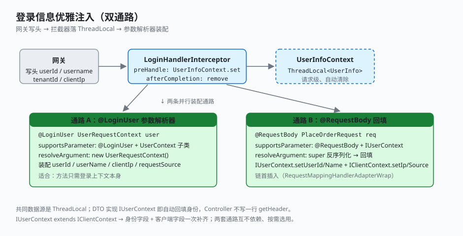

# 2.2 登录信息的优雅注入

网关已经鉴权完毕，把 `userId` / `username` / `clientIp` 写进请求头。业务侧不该再去 `request.getHeader(...)`——这套组件让 Controller 方法**像拿到普通参数一样拿到登录上下文**，且提供两条并行通路，按参数形态选用。

## 怎么用

两条通路都只要求「标个注解 / 实现个接口」，业务代码里看不到任何 `getHeader`。

### 用法 A：@LoginUser 拿独立的上下文参数

适合「方法只需要登录上下文本身」的场景——加个 `@LoginUser` 注解，登录信息就作为一个普通参数进来：

```java
@PostMapping("place-order")
public Result<Void> placeOrder(@LoginUser UserRequestContext user,
                               @RequestBody PlaceOrderRequest req) {
    user.getUserId();      // 直接用，无需 getHeader
    user.getClientIp();
    ...
}
```

### 用法 B：@RequestBody DTO 自动回填

适合「登录信息本就是 DTO 一部分」的场景——DTO 实现 `IUserContext`，反序列化完字段已自动回填，业务直接取：

```java
// PlaceOrderRequest implements IUserContext
@PostMapping("place-order")
public Result<Void> placeOrder(@RequestBody PlaceOrderRequest req) {
    req.getUserId();       // 进方法时已被回填，直接取
    ...
}
```

两套并行，互不依赖，按场景选用。

## 怎么实现的

两条通路共用一个数据源：请求进入时由拦截器把登录信息写进 `ThreadLocal`，解析器再从里面取出来填进参数或 DTO。

### 1. 拦截器写线程上下文

```java
// foundation-web: LoginHandlerInterceptor
public boolean preHandle(HttpServletRequest request, ...) {
    UserInfo userInfo = new UserInfo();
    userInfo.setUserId(request.getHeader("userId"));
    userInfo.setUsername(URLDecoder.decode(request.getHeader("username"), UTF_8));
    userInfo.setTenantId(request.getHeader("tenantId"));
    UserInfoContext.set(userInfo);        // ThreadLocal
    return true;
}
public void afterCompletion(...) { UserInfoContext.remove(); }   // 防线程复用串号
```

`UserInfoContext` 是一个 `ThreadLocal<UserInfo>`，请求进入写入、结束清除。这是两条注入通路的共同数据源。

### 2. @LoginUser 参数解析器

```java
// foundation-web: LoginUserHandlerMethodArgumentResolver
public boolean supportsParameter(MethodParameter p) {
    return p.hasParameterAnnotation(LoginUser.class)
        && UserContext.class.isAssignableFrom(p.getParameterType());
}
public Object resolveArgument(...) {
    UserRequestContext ctx = new UserRequestContext();
    UserInfo u = UserInfoContext.get();
    ctx.setUserId(u.getUserId());
    ctx.setUserName(u.getUsername());
    ctx.setClientIp(NetWorkUtil.getIpAddr(servletRequest));
    ctx.setRequestSource(LoginInfoUtils.getRequestSource(servletRequest));
    return ctx;
}
```

### 3. @RequestBody 回填处理器

```java
// foundation-web: LoginRequestBodyMethodProcessor extends RequestResponseBodyMethodProcessor
public boolean supportsParameter(MethodParameter p) {
    return p.hasParameterAnnotation(RequestBody.class)
        && IUserContext.class.isAssignableFrom(p.getParameterType());
}
public Object resolveArgument(...) {
    Object body = super.resolveArgument(...);     // 标准 @RequestBody 反序列化
    UserInfo u = UserInfoContext.get();
    if (u != null && body instanceof IUserContext) {
        ((IUserContext) body).setUserId(u.getUserId());
        ((IUserContext) body).setUserName(u.getUsername());
    }
    if (body instanceof IClientContext) {
        ((IClientContext) body).setClientIp(NetWorkUtil.getIpAddr(servletRequest));
        ((IClientContext) body).setRequestSource(LoginInfoUtils.getRequestSource(servletRequest));
    }
    return body;
}
```

`PlaceOrderRequest implements IUserContext`，所以 `@RequestBody PlaceOrderRequest` 进来时 `userId` 已被回填，业务代码直接 `request.getUserId()` 即可。

这条通路的关键是**插到解析器链首**——`RequestMappingHandlerAdapterWrap` 用 `InitializingBean` 把 `LoginRequestBodyMethodProcessor` add 到 `argumentResolvers` 的 0 号位，保证它先于标准 `RequestResponseBodyMethodProcessor` 命中。

### 4. 上下文类型层次

```
IClientContext (setClientIp / setRequestSource default)
  └─ ClientContext (requestSource, clientIp)
       └─ IUserContext (setUserId abstract, setUserName default)
            └─ UserContext (userId, userName)
                 └─ UserRequestContext（空扩展，请求态标记）
```

`IUserContext extends IClientContext`，所以回填 DTO 时身份字段和客户端字段一次补齐。



## 关键点

- **业务无感**：Controller 不写 `getHeader`，登录上下文像普通参数一样进来；DTO 实现 `IUserContext` 即自动回填。
- **两条通路并行**：`@LoginUser` 拿独立上下文参数，`@RequestBody` 把登录信息融进业务 DTO，互不依赖、按需选用。
- **线程上下文 + 清除**：`LoginHandlerInterceptor` 在 `preHandle` 写 ThreadLocal、`afterCompletion` 清除，避免线程池复用串号。
- **解析器链首插入**：`RequestMappingHandlerAdapterWrap` 用 `InitializingBean` 调整解析器顺序，保证 `@RequestBody` 回填先于标准处理器命中——这是 Spring MVC 的一个高级技巧。
- **接口契约驱动**：`IUserContext` / `IClientContext` 只声明所需 setter（default 空实现），DTO 按需实现，不被迫继承一堆字段。

---

← [上一节：2.1 锁的一种优雅实现](./01-lock.md) ｜ [下一节：2.3 数据落库的极简处理](./03-entity-interceptor.md) →
