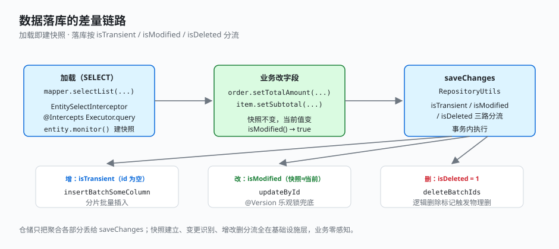

# 2.3 数据落库的极简处理

聚合根带一堆子集合（商品行、优惠、支付、费项），保存时要分清哪些新增、哪些改了、哪些删了。常规写法是业务层手动标记 `markLoaded`、手动比对、手动分流——这套组件把整件事下沉到一个 MyBatis 拦截器 + 一个仓储工具，**业务代码完全不感知差量**。

## 怎么用

### 不用这套组件（传统写法）

业务层得自己记快照、自己比对、自己分流，每个子集合都要抄一遍同样的判断：

```java
// 传统写法：手动标记 + 手动比对 + 手动分流
public void saveChanges(List<SalesOrder> orders) {
    for (SalesOrder order : orders) {
        SalesOrderEntity entity = order.getSalesOrderEntity();
        if (entity.getId() == null) {
            salesOrderEntityMapper.insert(entity);              // 新增
        } else if (entity.isModified()) {                       // 得自己维护快照、自己比对
            salesOrderEntityMapper.updateById(entity);          // 更新
        }
        for (OrderItem item : order.getItemList()) {
            if (item.getId() == null)            orderItemMapper.insert(item);
            else if (item.getIsDeleted() == 1)   orderItemMapper.deleteById(item.getId());
            else if (item.isModified())          orderItemMapper.updateById(item);
        }
        // 优惠、支付、费项……每个子集合都要再抄一遍同样的三分流
        // ...
    }
}
```

痛点很明显：每个子集合重复抄一遍分流逻辑、要手动维护「加载时快照」、漏判一个 `isDeleted` 就是脏数据，聚合越大越容易出错。

### 用了这套组件

业务仓储只管「把聚合的各部分丢给工具」，不写一句判断新增/更新/删除的逻辑：

```java
// business-infrastructure: SalesOrderRepositoryImpl
public void saveChanges(List<SalesOrder> orders) {
    for (SalesOrder order : orders) {
        RepositoryUtils.saveChanges(salesOrderEntityMapper, order.getSalesOrderEntity());
        RepositoryUtils.saveChanges(orderItemMapper,    order.getItemList());
        RepositoryUtils.saveChanges(discountMapper,     order.getDiscountList());
        RepositoryUtils.saveChanges(paymentMapper,      order.getPaymentList());
        RepositoryUtils.saveChanges(feeMapper,          order.getFeeList());
    }
}
```

加载时 `selectList` 返回的实体已被自动建好快照；业务改完字段；保存时工具按快照差量自动分流——仓储全程没写一句「判断是否新增/更新」。聚合根 + 各子集合分别丢给 `saveChanges`，整棵树一次性差量落库。

## 怎么实现的

业务代码之所以能这么省事，是因为差量识别被拆成两步下沉到了基础设施：加载时拦截器自动建快照，保存时工具按快照三路分流。

### 1. 加载即建快照

`EntitySelectInterceptor` 拦截 `Executor.query`，对 SELECT 返回的 `CreationAuditedEntity` 自动调 `monitor()`：

```java
// foundation-mybatis: EntitySelectInterceptor
@Intercepts({@Signature(type = Executor.class, method = "query",
    args = {MappedStatement.class, Object.class, RowBounds.class,
            ResultHandler.class, CacheKey.class, BoundSql.class})})
public class EntitySelectInterceptor implements Interceptor {
    public Object intercept(Invocation invocation) throws Throwable {
        Object result = invocation.proceed();
        if (result instanceof List) {
            for (Object entity : (List<?>) result) {
                if (entity instanceof CreationAuditedEntity) {
                    ((CreationAuditedEntity) entity).monitor();   // 自动建快照
                }
            }
        }
        return result;
    }
}
```

`monitor()` 在 `Entity` 基类里写入当前 hashCode 与 toString 快照；`isModified()` 对比快照判断是否变更；`isTransient()` 按 id 是否为空判断新建。

### 2. 落库即三路分流

`RepositoryUtils.saveChanges` 按 `isTransient` / `isModified` / `isDeleted` 三路分流：

```java
// foundation-mybatis: RepositoryUtils
public static <T extends CreationAuditedEntity, M extends ExtensionMapper<T>>
void saveChanges(M mapper, List<T> collection) {
    List<T> updated = collection.stream()
        .filter(e -> !e.isTransient() && e.isModified() && Objects.equals(e.getIsDeleted(), 0))
        .collect(Collectors.toList());                       // 改：有 id + 变了 + 未删
    List<T> added = collection.stream()
        .filter(Entity::isTransient).collect(Collectors.toList());   // 增：无 id
    List<T> deleted = collection.stream()
        .filter(e -> Objects.equals(e.getIsDeleted(), 1)).collect(Collectors.toList()); // 删

    deleted.forEach(batch -> mapper.deleteBatchIds(...));
    updated.forEach(item -> mapper.updateById(item));
    added 分片 → mapper.insertBatchSomeColumn(...);
}
```



## 关键点

- **业务无感**：仓储不手动 `markLoaded`、不手动比对字段，加载→改→存三步都由基础设施兜底。
- **快照在拦截器层建**：`EntitySelectInterceptor` 在 `Executor.query` 拦截，所有 SELECT 返回的实体自动 monitor，无侵入。
- **三路分流**：`isTransient`（无 id → INSERT）/ `isModified`（快照不一致 → UPDATE）/ `isDeleted`（逻辑删除标记 → DELETE），规则集中在一处。
- **聚合整树差量**：仓储把聚合根 + 各子集合分别丢给 `saveChanges`，整棵树一次性差量落库，事务内执行。
- **乐观锁兜底并发**：`CreationAuditedEntity` 带 `@Version`，`updateById` 命中乐观锁，并发修改直接失败而非覆盖。

---

← [上一节：2.2 登录信息的优雅注入](./02-login-inject.md) ｜ [下一节：2.4 全局日志处理](./04-logging.md) →
