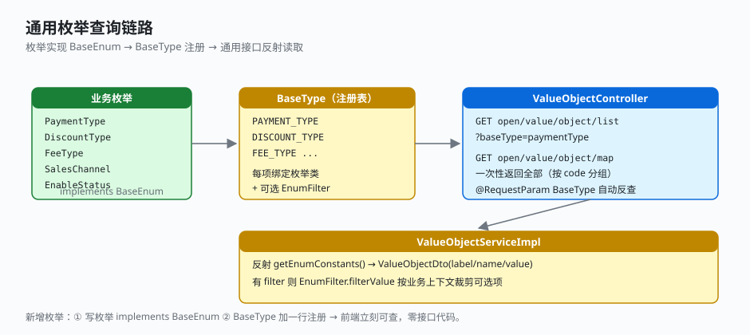

# 2.5 通用枚举查询

前端下拉框要查「支付方式有哪些」「费项类型有哪些」——每来一个枚举就写一个字典接口，重复且无趣。这套组件的做法是：**枚举实现一个三元组接口、在注册表登个记，前端就能通用查询**，新增枚举零接口代码。

## 怎么用

### 不用这套组件（传统写法）

每来一个枚举就抄一套 Controller + Service，新增一个字典就得改三处：

```java
// 支付方式字典接口
@GetMapping("payment-type/list")
public Result<List<DictDto>> paymentTypeList() {
    return Result.success(Arrays.stream(PaymentType.values())
        .map(e -> new DictDto(e.getCode(), e.getName()))
        .collect(Collectors.toList()));
}

// 费项类型字典接口……再抄一遍
@GetMapping("fee-type/list")
public Result<List<DictDto>> feeTypeList() { ... }
// 优惠类型、销售渠道、启用状态……每个枚举都要再抄一个接口
```

### 用了这套组件

新增一个枚举只需两步，**不写任何接口代码**：

**① 枚举实现 `BaseEnum` 三元组：**

```java
// business-domain: PaymentType
public enum PaymentType implements BaseEnum<String, String, String> {
    ALIPAY("alipay", "支付宝"),
    WECHAT("wechat", "微信支付"),
    BALANCE("balance", "余额"),
    BANK_CARD("bankCard", "银行卡");

    private final String code;
    private final String name;
    // getValue() 返回 code
}
```

**② 在 `BaseType` 加一行注册：**

```java
// business-application: BaseType implements BaseEnum<String, String, String>
PAYMENT_TYPE("paymentType", "支付方式", PaymentType.class),
// ... 加一行即生效
```

前端调通用接口即可，`baseType` 传注册 code：

```
GET open/value/object/list?baseType=paymentType      → 支付方式列表
GET open/value/object/map                            → 全部字典一次性返回
```

## 怎么实现的

### 1. 枚举契约：BaseEnum 三元组

```java
// foundation-domain: BaseEnum<T, I, J>
public interface BaseEnum<T, I, J> {
    T getCode();    // 业务 code（如 "alipay"）
    I getName();    // 展示名（如 "支付宝"）
    J getValue();   // 值
}
```

所有业务枚举同一形态，可被通用机制统一处理。

### 2. 注册表：BaseType

每个枚举在 `BaseType` 注册一项，可选拴一个 `EnumFilter` 做业务裁剪：

```java
// business-application: BaseType implements BaseEnum<String, String, String>
PAYMENT_TYPE("paymentType", "支付方式", PaymentType.class),
DISCOUNT_TYPE("discountType", "优惠类型", DiscountType.class),
FEE_TYPE("feeType", "费项类型", FeeType.class),
SALES_CHANNEL("salesChannel", "销售渠道", SalesChannel.class),
ENABLE_STATUS("enableStatus", "启用状态", EnableStatus.class);
```

`BaseType` 把「枚举类」与「对外 code」绑定，新增枚举只加一行注册，Controller/Service 一行不改。

### 3. 通用接口：一个 Controller 通吃

```java
// business-web: ValueObjectController  (路径 open/value/object)
@GetMapping("list")
public Result<List<ValueObjectDto>> list(@RequestParam BaseType baseType) {
    return Result.success(valueObjectService.valueList(baseType));
}
@GetMapping("map")
public Result<Map<String, List<ValueObjectDto>>> map() {
    return Result.success(valueObjectService.valueMap());   // 一次性返回全部，按 code 分组
}
```

`@RequestParam BaseType` 直接接收枚举 code 字符串反查为 `BaseType`（`BaseType.codeOf` 走 `EnumUtils.codeOf`）。

### 4. 服务实现：反射读常量

```java
// business-application: ValueObjectServiceImpl
public List<ValueObjectDto> valueList(BaseType baseType) {
    BaseEnum[] constants = baseType.getEnumClass().getEnumConstants();
    List<ValueObjectDto> list = Arrays.stream(constants)
        .map(e -> new ValueObjectDto(e.getName(), e.getName(), e.getCode().toString()))
        .collect(Collectors.toList());
    if (baseType.getFilter() != null) {
        EnumFilter filter = findFilter(baseType);     // 按业务上下文裁剪
        if (filter != null) list = filter.filterValue(list);
    }
    return list;
}
```

`getEnumConstants()` 直接取枚举项，无需为每类枚举写字典转换；`EnumFilter` 让同一枚举在不同业务上下文露出不同可选项（如某渠道只支持部分支付方式）。



## 关键点

- **契约驱动**：`BaseEnum` 统一 code/name/value 三元组，所有业务枚举同一形态，可被通用机制处理。
- **注册表解耦**：`BaseType` 把「枚举类」与「对外 code」绑定，新增枚举只加一行注册，Controller/Service 一行不改。
- **反射读常量**：`getEnumConstants()` 直接取枚举项，无需为每类枚举写字典转换。
- **按业务裁剪**：`EnumFilter` 让同一枚举在不同业务上下文露出不同可选项（如某渠道只支持部分支付方式），扩展点干净。
- **批量拉取**：`map` 接口一次性返回所有枚举字典，前端首屏加载省去多次请求。

---

← [上一节：2.4 全局日志处理](./04-logging.md) ｜ [下一节：3.1 下单场景](../03-trade-scenarios/01-place-order.md) →
