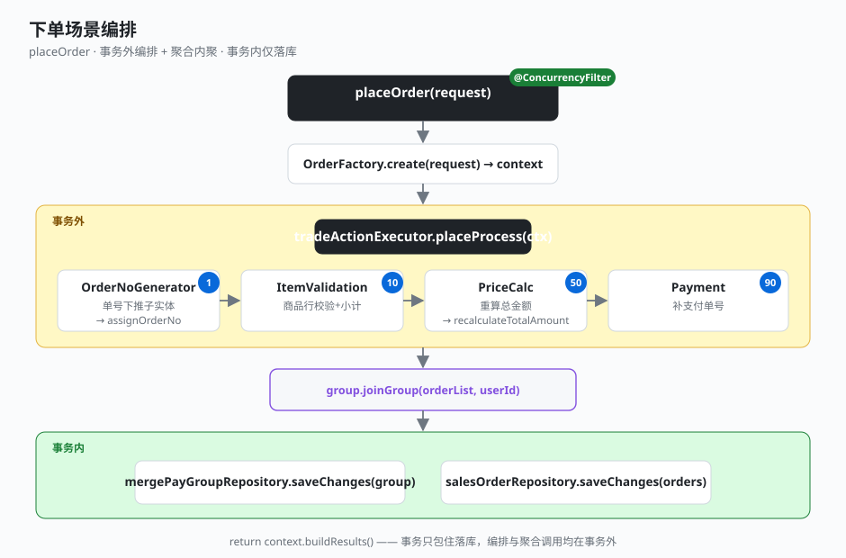

# 3.1 下单场景

下单是一条「装配 → 编排 → 挂组 → 落库」的链路。应用服务只做编排和事务边界，校验、算价、单号生成下沉到处理器链，一致性逻辑内聚到聚合。一眼看完整个 `placeOrder`：

## 全貌：placeOrder

```java
// business-application: TradeAppServiceImpl
@Override
@ConcurrencyFilter(waitTime = 1000, leaseTime = 5000)   // 分布式锁防并发
public List<PlaceOrderResult> placeOrder(PlaceOrderRequest request) {
    PlaceOrderContext context = OrderFactory.create(request);          // 装配聚合
    // 事务外：单号生成 + 校验 + 算价 + 支付明细
    tradeActionExecutor.placeProcess(context);
    context.getGroup().joinGroup(context.getOrderList(),                // 聚合内聚：挂组
            context.getUserRequestContext().getUserId());
    // 事务内：仅落库
    transactionTemplate.executeWithoutResult(status -> {
        mergePayGroupRepository.saveChanges(context.getGroup());
        salesOrderRepository.saveChanges(context.getOrderList());
    });
    return context.buildResults();
}
```

四件事一眼分明：**锁**（`@ConcurrencyFilter`）、**事务边界**（只包住落库）、**处理器编排**（事务外）、**聚合内聚**（`joinGroup` 在聚合上调用）。

## processor 链（事务外编排）

`placeProcess` 按 sort 升序执行 4 个 processor，每个只做一类事：

| sort | processor | 职责 | 是否委托聚合 |
|------|-----------|------|--------------|
| 1 | OrderNoGeneratorProcessor | 生成订单号 + 合并支付组号，下推子实体 | 是（`assignOrderNo` / `assignGroupNo`） |
| 10 | ItemValidationProcessor | 商品行非空、数量单价校验、算小计 | 否（写 item 字段） |
| 50 | PriceCalcProcessor | 重算订单总金额 | 是（`recalculateTotalAmount`） |
| 90 | PaymentProcessor | 为缺失支付单号的记录补单号 | 否（写 payment 字段） |

sort=1 的处理器生成单号后，通过聚合方法下推到所有子实体，保证聚合内单号一致：

```java
// OrderNoGeneratorProcessor
public void process(PlaceOrderContext context) {
    MergePayGroup group = context.getGroup();
    if (StringUtils.isBlank(group.getGroupNo())) {
        group.assignGroupNo(nextNo());
    }
    String groupNo = group.getGroupNo();
    for (SalesOrder order : context.getOrderList()) {
        order.assignOrderNo(nextNo(), groupNo);   // 单号下推由聚合负责
    }
}
```

## 聚合内聚点

处理器只「触发」，写聚合字段的逻辑全在聚合内。`SalesOrder.assignOrderNo` 把单号下推到商品行、优惠、支付、费项四类子实体；`recalculateTotalAmount` 把算价公式收在聚合里：

```java
// business-domain: SalesOrder
public void assignOrderNo(String orderNo, String groupNo) {
    salesOrderEntity.setOrderNo(orderNo);
    salesOrderEntity.setMergePayGroupId(groupNo);
    if (itemList != null)    itemList.forEach(i -> i.setOrderNo(orderNo));
    if (discountList != null) discountList.forEach(d -> d.setOrderNo(orderNo));
    if (paymentList != null) paymentList.forEach(p -> p.setOrderNo(orderNo));
    if (feeList != null)     feeList.forEach(f -> f.setOrderNo(orderNo));
}

/** 总金额 = 商品小计之和 − 优惠之和 + 费项之和 */
public void recalculateTotalAmount() {
    BigDecimal itemTotal = sum(itemList, OrderItem::getSubtotal);
    BigDecimal discountTotal = sum(discountList, Discount::getAmount);
    BigDecimal feeTotal = sum(feeList, Fee::getAmount);
    salesOrderEntity.setTotalAmount(itemTotal.subtract(discountTotal).add(feeTotal));
}
```

挂组同样在聚合：`MergePayGroup.joinGroup` 取第一单作主单、校验重复加入、逐单调 `SalesOrder.joinGroup` 写回组号——应用服务一行 `group.joinGroup(...)` 就够了，内部规则全在聚合。



## 关键点

- **事务只包落库**：`placeProcess`（含单号生成、校验、算价）和 `joinGroup` 都在事务外，只有 `saveChanges` 进事务——长耗时和可能抛业务异常的操作不占用事务连接。
- **处理器只编排**：4 个 processor 各管一类事，写聚合字段的逻辑下沉到 `assignOrderNo` / `recalculateTotalAmount` / `joinGroup`，processor 不探入聚合内部字段。
- **单号下推在聚合**：`assignOrderNo` 一次性把单号推到商品行/优惠/支付/费项，保证聚合内一致——这规则不该散落在各 processor 里。
- **TreeSet 一次排序**：`TradeActionExecutor` 构造时把 processor 装入 `TreeSet` 排定，调用时 `forEach` 按序执行，热路径上不重复排序。
- **锁贴在应用服务**：`@ConcurrencyFilter` 标在 `placeOrder` 上，防同一请求并发下单，与 2.1 的优雅锁实现呼应。

---

← [上一节：2.5 通用枚举查询](../02-foundation-elegance/05-enum-query.md) ｜ [下一节：3.2 结算场景](./02-settle.md) →
