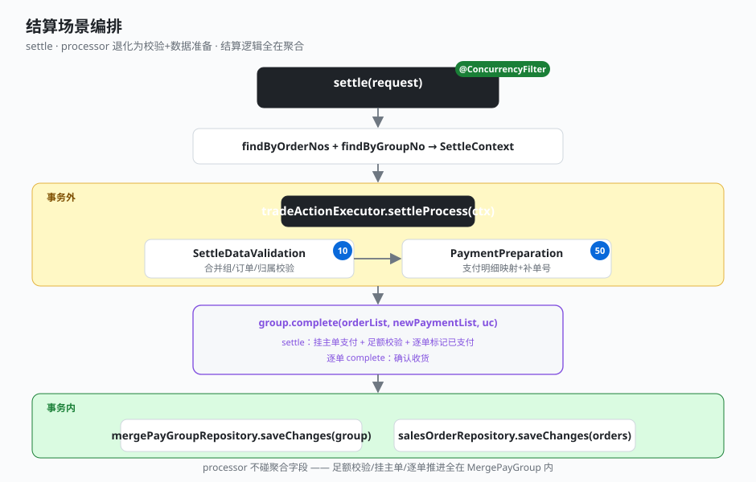

# 3.2 结算场景

结算是「加载 → 编排 → 合并结算 → 落库」。和下单同构，但聚合内聚更重——足额校验、挂主单、逐单结算/完成全压在 `MergePayGroup` 上。

## 全貌：settle

```java
// business-application: TradeAppServiceImpl
@Override
@ConcurrencyFilter(waitTime = 1000, leaseTime = 5000)
public List<SettleResult> settle(SettleRequest request) {
    List<SalesOrder> lastOrderList = salesOrderRepository.findByOrderNos(request.getOrderNoList());
    MergePayGroup group = mergePayGroupRepository.findByGroupNo(request.getMergePayGroupId());
    SettleContext context = new SettleContext(group, lastOrderList, request);
    // 事务外：结算处理链（校验 + 支付明细准备）
    tradeActionExecutor.settleProcess(context);
    // 聚合内聚：合并支付结算（足额校验 + 逐单已支付）+ 逐单完成
    group.complete(lastOrderList, context.getNewPaymentList(), context.getUserRequestContext());
    // 事务内：仅落库
    transactionTemplate.executeWithoutResult(status -> {
        mergePayGroupRepository.saveChanges(group);
        salesOrderRepository.saveChanges(lastOrderList);
    });
    return context.buildResults();
}
```

结构和 `placeOrder` 完全一致：加载 → 事务外编排 → 聚合内聚调用 → 事务内落库。区别在聚合那一行——`group.complete` 内部干了一连串事。

## processor 链（事务外编排）

`settleProcess` 只有 2 个 processor，更轻：

| sort | processor | 职责 | 是否委托聚合 |
|------|-----------|------|--------------|
| 10 | SettleDataValidationProcessor | 合并组存在、订单存在且未完成、归属当前合并组 | 否（只校验） |
| 50 | PaymentPreparationProcessor | 请求支付明细映射为 Payment 实体、补单号，装入 newPaymentList | 否（组装数据） |

结算的 processor 退化为「校验 + 数据准备」，完全不碰聚合字段——真正的结算逻辑都在聚合里。

## 聚合内聚点

`group.complete` 一行背后是整条结算链：先 `settle`（挂主单支付、足额校验、逐单标记已支付），再逐单 `complete`（确认收货）。

```java
// business-domain: MergePayGroup
public void complete(List<SalesOrder> orderList, List<Payment> newPaymentList,
                     UserRequestContext userRequestContext) {
    settle(orderList, newPaymentList, userRequestContext);        // 合并支付结算
    for (SalesOrder order : orderList) {
        if (!Boolean.TRUE.equals(order.isCompleted())) {
            order.complete(userRequestContext);                   // 逐单确认收货
        }
    }
}

/** 本次支付明细挂到主单，校验合并组已支付额 ≥ 应支付额，足额后逐单标记已支付 */
public void settle(List<SalesOrder> orderList, List<Payment> newPaymentList,
                   UserRequestContext userRequestContext) {
    // ... 归属校验、找主单、newPaymentList 挂到主单 primaryOrder.addPayList(newPaymentList, false)
    BigDecimal groupTotal = ...; BigDecimal groupPaid = ...;      // 累加各单 totalAmount / paidAmount
    if (groupPaid.compareTo(groupTotal) < 0) {
        throw new BizException("合并支付金额不足，应支付 " + groupTotal + " ，已支付 " + groupPaid);
    }
    for (SalesOrder order : orderList) {
        order.settle(userRequestContext);                          // 逐单标记已支付
    }
}
```

单张订单的结算规则也在聚合：`SalesOrder.settle` 校验未重复结算、把已支付额记为总金额、置已结算态；`SalesOrder.addPayList` 按支付单号去重追加。这些规则都不该出现在应用服务或 processor 里。



## 关键点

- **processor 进一步退化**：结算的 processor 只做校验和数据准备，连聚合字段都不写——对比下单，这里「聚合内聚」规则更彻底。
- **一行 `group.complete` 背后是整条链**：足额校验、挂主单、逐单结算、逐单完成，全在聚合内串联，应用服务无需知晓内部步骤。
- **跨聚合协调在聚合**：`MergePayGroup` 持有多张 `SalesOrder`，合并支付的「主单挂支付 + 总额平衡 + 逐单推进」由它统一协调，`SalesOrder` 只管自身状态流转。
- **事务边界同下单**：`settleProcess` 和 `group.complete` 在事务外，只有 `saveChanges` 进事务——可能抛 `BizException`（金额不足、重复结算）的操作不进事务。
- **锁同样贴应用服务**：`@ConcurrencyFilter` 防并发结算，与下单一致。

---

← [上一节：3.1 下单场景](./01-place-order.md) ｜ [下一节：3.3 串联回顾](./03-recap.md) →
