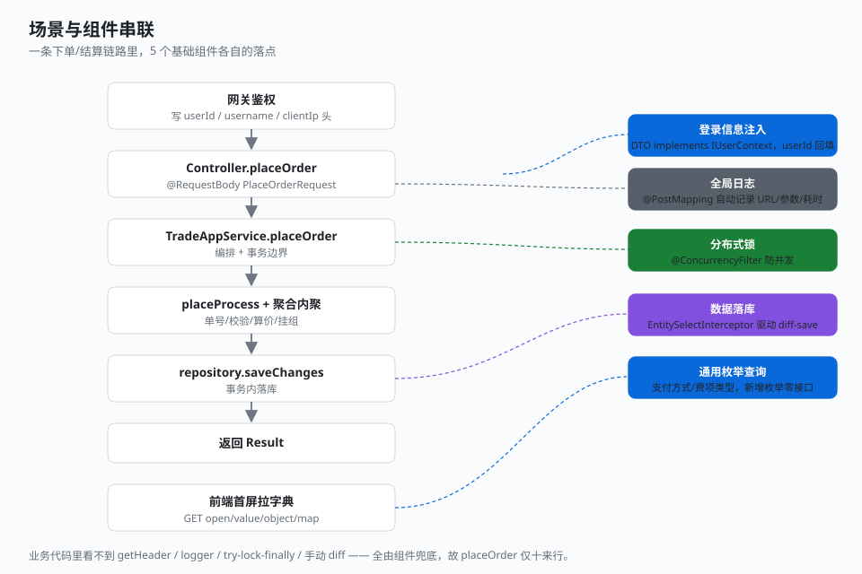

# 3.3 串联回顾

前面两部分是「点」——基础组件一个个看实现，业务场景一条条看编排。这一节把它们串起来：同一条下单/结算链路里，第二部分的 5 个组件分别落在哪。

## 组件落点

| 组件 | 在场景里的落点 | 体现 |
|------|----------------|------|
| **登录信息注入** | `PlaceOrderRequest implements IUserContext`，请求进来时 `userId` 已被回填 | Controller 不写 `getHeader`，`OrderFactory` 直接 `request.getUserId()` |
| **全局日志** | `placeOrder` / `settle` 带 `@PostMapping`，`LoggingInterceptor` 自动记录 URL/参数/响应/耗时 | 方法体零 logger，异常也自动 error 级记录后 rethrow |
| **分布式锁** | `@ConcurrencyFilter(waitTime=1000, leaseTime=5000)` 标在两个应用服务方法上 | 同一请求并发下单/结算被锁挡住，业务代码无锁逻辑 |
| **数据落库** | `saveChanges` 时 `EntitySelectInterceptor` 建的快照驱动 diff-save | 下单全量 INSERT；结算仅 UPDATE 已结算/已完成标记，仓储不写判断 |
| **通用枚举查询** | 前端首屏 `GET open/value/object/map` 拉支付方式/费项类型字典 | 下单页下拉框的选项来自这一接口，新增枚举零接口代码 |

## 贯穿主线

> processor 只做**生成策略 + 编排 + 跨聚合协调 + 事务边界**；聚合自身的一致性逻辑内聚到聚合。

下单和结算两个场景都在重复这条主线：

- **应用服务**——开事务边界、调处理器链、做聚合间协调，不写业务规则。
- **处理器**——各管一类事（单号、校验、算价、支付准备），只编排触发，不探入聚合字段。
- **聚合**——单号下推、算价公式、挂组、足额校验、逐单结算/完成，一致性逻辑全收在 `SalesOrder` / `MergePayGroup` 内。
- **基础组件**——锁、日志、登录注入、落库、枚举查询，把横切关注点下沉成「一行注解/一个拦截器」，业务代码 thus 能写得很干净。

基础组件是「点」，业务场景是「线」，点线结合体现整体架构之美——这正是这次分享想让大家看到的样子。

## 关键点

- **五组件各司其职**：登录注入管入参、日志管观测、锁管并发、落库管差量、枚举查询管字典，互不耦合，却都在同一条链路上生效。
- **业务代码因此极简**：`placeOrder` / `settle` 各十来行，没有 `getHeader`、没有 `logger`、没有 `try-lock-finally`、没有手动 diff——全是组件兜底。
- **主线一致**：编排归处理器、一致性归聚合、横切归组件，三个场景（含概览里的 1.5）都在重复同一套约定，这就是「写法」层面的美感。

---

← [上一节：3.2 结算场景](./02-settle.md) ｜ [总目录](../README.md) →
